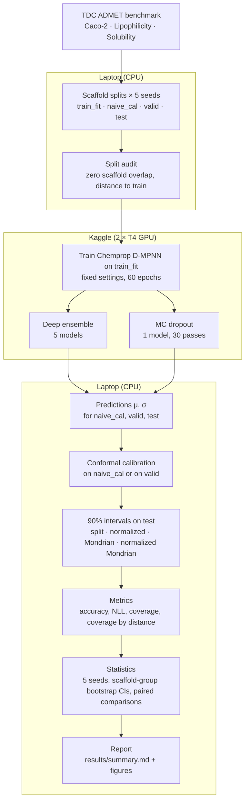

# MolCalib

**TL;DR** (exploratory; deep ensemble, split conformal, target coverage 0.90, mean of 5 seeds, 95% CIs)
1. Solubility: test coverage 0.866 [0.828, 0.905] when calibrated on a random hold-out of training molecules, 0.918 [0.892, 0.938] on a scaffold-disjoint validation set, and 0.918 [0.895, 0.935] (test-only CI) with the validation set cut to the hold-out's size.
2. The higher coverage comes with wider intervals (+0.858 [+0.369, +1.149]) and no better Winkler interval score (5.199 vs 5.286, difference +0.087 [−0.188, +0.222]).
3. No coverage difference was detected on Caco-2 or lipophilicity; 14 of 96 calibration-source comparisons have a CI excluding zero, with no multiple-comparison correction.

An evaluation of established uncertainty quantification (UQ) methods for molecular property
prediction under scaffold shift: deep ensembles, MC dropout, and split / normalized / Mondrian
conformal prediction, applied to a Chemprop D-MPNN on three TDC ADMET regression tasks.

## Workflow



## 1. Question

On scaffold-split TDC ADMET tasks:

1. Does split conformal prediction reach its nominal 90% coverage on the test set?
2. Does that depend on where the calibration data comes from: a random hold-out of the training
   molecules (`naive_cal`) or a scaffold-disjoint validation set (`valid`)?
3. How does UQ quality change with a molecule's distance from the training set?

## 2. Setup

| | |
|---|---|
| Tasks | TDC `admet_group`: `caco2_wang`, `lipophilicity_astrazeneca`, `solubility_aqsoldb` (regression) |
| Splits | TDC train/valid scaffold split per seed; fixed TDC test set; `naive_cal` = random 10% of train |
| Seeds | 1-5 (split seed; model seeds derived from it, see `molcalib/config.py`) |
| Model | Chemprop v2 D-MPNN, hidden 300, depth 3, mean aggregation, dropout 0.1, mean-variance (Gaussian NLL) head |
| Training | Chemprop default optimiser and LR schedule, batch 64, fixed 60 epochs, last epoch kept; no tuning, no checkpoint selection |
| UQ | 5-member deep ensemble; MC dropout (1 model, T = 30); total variance = mean predicted variance + variance of means |
| Conformal | split, normalized (by σ), Mondrian and normalized Mondrian (bins = calibration quartiles of distance to train), each calibrated on `naive_cal` and on `valid`; α = 0.1 |
| Distance | 1 − max Tanimoto similarity to `train_fit` (Morgan radius 2, 2048 bits) |
| Statistics | mean ± sd over 5 seeds; 95% CIs from 1000 bootstrap resamples of test scaffold groups (and, separately, of calibration scaffold groups with refitted conformal quantiles); paired comparisons |

Splits have zero scaffold overlap between `train_fit`, `valid` and `test` for every task and seed
(`results/split_audit.json`). Design choices not fixed in advance are recorded in
[docs/DESIGN.md](docs/DESIGN.md).

## 3. Prior work

This repository applies existing methods; it does not propose new ones.

- Deep ensembles: Lakshminarayanan, Pritzel & Blundell, *Simple and Scalable Predictive
  Uncertainty Estimation using Deep Ensembles*, NeurIPS 2017.
- MC dropout: Gal & Ghahramani, *Dropout as a Bayesian Approximation*, ICML 2016.
- Mean-variance estimation: Nix & Weigend, *Estimating the mean and variance of the target
  probability distribution*, IEEE ICNN 1994.
- Conformal prediction, including Mondrian conformal prediction: Vovk, Gammerman & Shafer,
  *Algorithmic Learning in a Random World*, Springer 2005.
- Normalized nonconformity scores: Papadopoulos, Vovk & Gammerman, *Regression Conformal Prediction
  with Nearest Neighbours*, JAIR 40, 815-840 (2011).
- Split conformal for regression: Lei, G'Sell, Rinaldo, Tibshirani & Wasserman,
  *Distribution-Free Predictive Inference for Regression*, JASA 2018.
- Conformal prediction under covariate shift (weighted conformal): Tibshirani, Barber, Candès &
  Ramdas, *Conformal Prediction Under Covariate Shift*, NeurIPS 2019. Not applied here; see
  Limitations.
- Interval (Winkler) score: Winkler, *A Decision-Theoretic Approach to Interval Estimation*,
  JASA 67, 187-191 (1972); Gneiting & Raftery, *Strictly Proper Scoring Rules, Prediction, and
  Estimation*, JASA 102, 359-378 (2007).
- D-MPNN: Yang et al., *Analyzing Learned Molecular Representations for Property Prediction*,
  J. Chem. Inf. Model. 59(8), 3370-3388 (2019).
- Chemprop: Heid et al., *Chemprop: A Machine Learning Package for Chemical Property Prediction*,
  J. Chem. Inf. Model. 64(1), 9-17 (2024); Graff, Morgan et al., *Chemprop v2: An Efficient,
  Modular Machine Learning Package for Chemical Property Prediction*, J. Chem. Inf. Model. 66(1),
  28-33 (2026), DOI 10.1021/acs.jcim.5c02332.
- UQ for molecular property prediction: Hirschfeld, Swanson, Yang, Barzilay & Coley,
  *Uncertainty Quantification Using Neural Networks for Molecular Property Prediction*,
  J. Chem. Inf. Model. 60(8) (2020); Scalia, Grambow, Pernici, Li & Green, *Evaluating Scalable
  Uncertainty Estimation Methods for Deep Learning-Based Molecular Property Prediction*,
  J. Chem. Inf. Model. 60(6), 2697-2717 (2020).
- Data: Huang et al., *Therapeutics Data Commons*, NeurIPS Datasets and Benchmarks 2021
  (arXiv:2102.09548). Original data sources and licences: [splits/README.md](splits/README.md).
- Scaffolds: Bemis & Murcko, *The Properties of Known Drugs. 1. Molecular Frameworks*,
  J. Med. Chem. 39, 2887-2893 (1996).

## 4. Reproduce

Requires [PDM](https://pdm-project.org) and Python 3.11. Local work is CPU-only.

```bash
make setup-cpu          # pdm install -G data -G deep, then a CPU build of torch
make test lint
make splits audit       # TDC download -> splits/*.csv, results/split_audit.json
```

Training (90 models) ran on Kaggle (2 × T4, about 30 minutes). To repeat it, see
[kaggle/README.md](kaggle/README.md): `make kaggle-smoke`, then `make kaggle-full` and
`make kaggle-fetch-full`. Every Kaggle run is preceded by a CPU smoke test (`make smoke`).

To skip training, use the committed predictions:

```bash
python scripts/pack_preds.py --unpack   # results/preds.zip -> cache/preds/
make evaluate                           # conformal, metrics, statistics, report
```

`make evaluate` rewrites `results/metrics_*.csv`, `results/stats_*.csv`, `results/summary.md`
and the figures. Every results file records the git commit that produced it.

## 5. Results

All results are measured on each task's held-out test set and averaged over the 5 split seeds.
*Coverage* is the fraction of test molecules whose measured value falls inside the predicted 90%
interval, so a well-calibrated method sits at 0.90; lower values mean the intervals are too
narrow. Brackets are 95% CIs that resample both test and calibration scaffold groups. The tables
below show the deep ensemble; MC dropout behaves similarly. All tables and figures, for both base
methods and every conformal variant, are in **[results/summary.md](results/summary.md)**,
generated by `make evaluate`.

**Split conformal coverage by calibration source (target 0.90)**

| Task | `naive_cal` | `valid` | `valid` − `naive_cal` | Seeds with `valid` higher |
|---|---|---|---|---|
| Caco-2 | 0.916 [0.839, 0.956] | 0.922 [0.847, 0.966] | +0.005 [−0.024, +0.042] | 4/5 |
| Lipophilicity | 0.896 [0.856, 0.920] | 0.906 [0.877, 0.928] | +0.010 [−0.018, +0.045] | 4/5 |
| Solubility | 0.866 [0.828, 0.905] | 0.918 [0.892, 0.938] | +0.052 [+0.016, +0.082] | 5/5 |

- **Exploratory.** On solubility, calibrating on the scaffold-disjoint `valid` set gave higher
  coverage than the random hold-out in every seed, and the CI of the difference excludes zero.
  This is one of 96 `valid` − `naive_cal` comparisons (4 metrics × 4 conformal variants × 2 base
  methods × 3 tasks). 14 of the 96 have a test+cal CI that excludes zero, and there is no
  multiple-comparison correction. 12 of the 14 are the solubility coverage, width and
  far-quartile coverage of split and normalized conformal; the other 2 are solubility Winkler
  scores of normalized Mondrian conformal, where `valid` scores better
  ([summary.md §7.4](results/summary.md)).
- On lipophilicity and Caco-2 we found no difference that the CIs can distinguish from zero
  (negative result). Caco-2 has 182 test molecules in 72 scaffold groups, so its CIs are wide.
- The solubility gain is not free: the split-conformal intervals calibrated on `valid` are about
  28% wider (mean width 3.05 → 3.91; paired difference +0.86 [+0.37, +1.15]).
- The gain is specific to split (and normalized) conformal. For Mondrian conformal the
  `valid` − `naive_cal` coverage difference on solubility includes zero (+0.006 [−0.019, +0.031]).

**Post-hoc checks of the calibration-source result** (chosen after seeing the results, in response
to review; [summary.md §7](results/summary.md), [DR-006](docs/DESIGN.md))

- *Calibration-set size.* `naive_cal` is smaller than `valid` on every task and seed (699 vs 999
  molecules on solubility, seed 1), so size and source are confounded. Refitting split conformal
  on 200 random subsamples of `valid` with the `naive_cal` size gave the same coverage as the full
  `valid` set: solubility 0.918 [0.895, 0.935] (full `valid` 0.918 [0.896, 0.935]), lipophilicity
  0.907 [0.888, 0.924] (0.906 [0.887, 0.923]), Caco-2 0.924 [0.860, 0.966] (0.922 [0.857, 0.966]).
  These CIs resample test scaffold groups only. The smaller size of `naive_cal` therefore does not
  explain its lower coverage on solubility. This rules out size, not other differences between
  the two sets.
- *Interval quality.* `valid` calibration brings solubility coverage to the nominal level but
  does not give a better interval score. The Winkler score (width plus a penalty of 2/α times the
  distance of each miss; lower is better) is 5.199 [4.739, 5.914] with `naive_cal` and
  5.286 [4.916, 5.811] with `valid`; the paired difference is +0.087 [−0.188, +0.222], positive in
  1 of 5 seeds. The extra width roughly cancels the smaller miss penalties. The split-conformal
  differences on Caco-2 (+0.016 [−0.122, +0.107]) and lipophilicity (+0.031 [−0.044, +0.082]) also
  include zero. Comparing coverage at matched width was not done: for split conformal both sources
  use the same model and a constant margin, so at equal width the intervals are identical.
- *Likely mechanism (descriptive).* On solubility 89% of `naive_cal` molecules share a scaffold
  with `train_fit` (summary.md §1). The median absolute error on `naive_cal` is 0.41 ± 0.02,
  against 0.63 ± 0.06 on `valid` and 0.61 ± 0.02 on test (mean ± sd over seeds). So errors on
  `naive_cal` look smaller than on test, and a margin calibrated there is too small for test. On
  lipophilicity (0.33 / 0.36 / 0.36) and Caco-2 (0.29 / 0.34 / 0.28), where 54-60% of `naive_cal`
  shares a training scaffold, the `naive_cal` and test errors are close. This is consistent with
  the explanation but does not prove it: no test was applied, and other differences between the
  splits are not ruled out.

**Coverage on the test molecules farthest from the training set** (top quartile of distance)

| Task | split, `naive_cal` | split, `valid` | Mondrian, `naive_cal` | Mondrian, `valid` |
|---|---|---|---|---|
| Lipophilicity | 0.798 [0.728, 0.847] | 0.811 [0.756, 0.858] | 0.926 [0.866, 0.959] | 0.911 [0.838, 0.940] |

- With one margin for all molecules, split conformal under-covers the farthest quartile on
  lipophilicity for both calibration sources, although its overall coverage is close to 0.90.
  Mondrian conformal (one margin per distance bin) brings it to about 0.9, at a cost in width:
  on lipophilicity its intervals are about 9% wider than split's under `naive_cal` calibration
  (mean width 1.83 → 2.00) and about the same under `valid` calibration (1.93 → 1.91).
  

**Other results** (details and CIs in summary.md)

- The model's own Gaussian intervals are too narrow (signed miscalibration < 0) for MC dropout on
  all three tasks and for deep ensembles on lipophilicity and solubility, with CIs excluding zero.
  For Caco-2 deep ensembles all 5 seeds are negative (−0.049) but the CI [−0.140, +0.016]
  includes zero.
- Deep ensembles had slightly lower test MAE than MC dropout on lipophilicity
  (−0.018 [−0.024, −0.013], test-only CI) and solubility (−0.012 [−0.021, −0.004]); no difference
  was detected on Caco-2. Ensembles cost 5× the training compute (about 37 of the 45 GPU-minutes).
- Spearman correlation between predicted σ and absolute error is weak (about 0.07-0.23).

## 6. Limitations and future work

- Three regression tasks only.
- Scaffold shift violates the exchangeability between calibration and test data that conformal
  coverage guarantees assume. Weighted conformal prediction under covariate shift (Tibshirani et
  al. 2019), which reweights calibration scores by an estimated test/calibration likelihood ratio,
  is the standard remedy and was not tested here. Mondrian conformal on distance bins, which was
  tested, is a coarse, bin-based alternative that adjusts only along the binned distance.
- Marginal coverage (and coverage per distance bin) only; no conditional coverage guarantees.
- Fixed hyperparameters chosen in advance, not tuned; results may differ for tuned models.
- How TDC built its `test.csv` was not verified from source; scaffold disjointness was checked
  empirically (split audit).
- The TDC test set is the same for all seeds, so seeds vary training, calibration and validation
  data but not the test molecules; test sampling is covered by the scaffold-group bootstrap.
- CIs hold the trained models fixed. 186 paired comparisons are reported
  (`results/stats_paired.csv`) with no multiple-comparison correction.
- The size-matched control, the Winkler score and the median-error check were chosen after seeing
  the results (DR-006). The size-matched control has test-only CIs and no paired comparison.
- Caco-2 is small (64 / 91 calibration molecules), so Mondrian bins hold about 16-23 molecules
  and its conformal results are noisy.
- GPU (Kaggle) and CPU runs are not bit-identical; only close agreement was checked.
- Data licences differ by task and are not covered by the MIT licence: solubility CC BY 4.0,
  lipophilicity CC BY-SA 3.0 (ChEMBL), Caco-2 unconfirmed. See [splits/README.md](splits/README.md).

## Layout

```
molcalib/   config, data (splits), audit, models, train, runner, conformal, metrics, stats, report
scripts/    make_splits, audit, train_all, evaluate, kaggle_ctl, pack_preds
splits/     committed split files        results/   metrics, statistics, summary.md, figures, preds.zip
kaggle/     notebook template            docs/      design log, setup report, plan, eval protocol
```

## Licence and citation

MIT licence for the code. Data files (`splits/`, `results/preds.zip`) keep their source
licences; see [splits/README.md](splits/README.md). Citation: [CITATION.cff](CITATION.cff).
