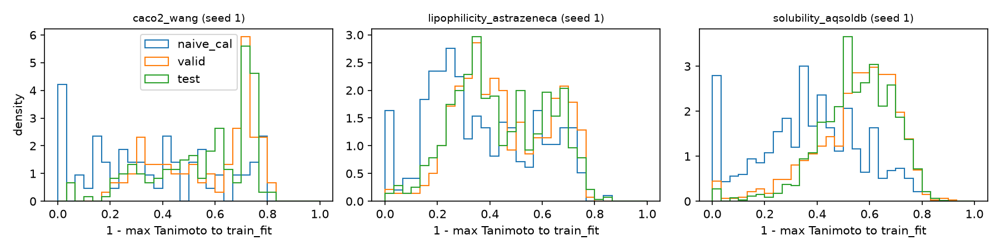
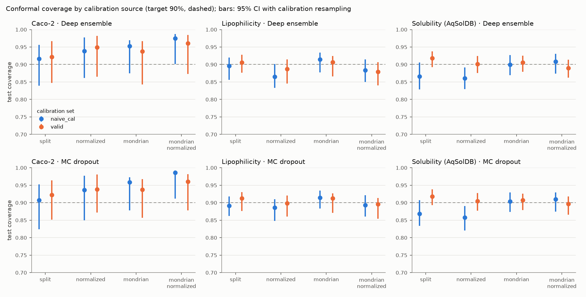
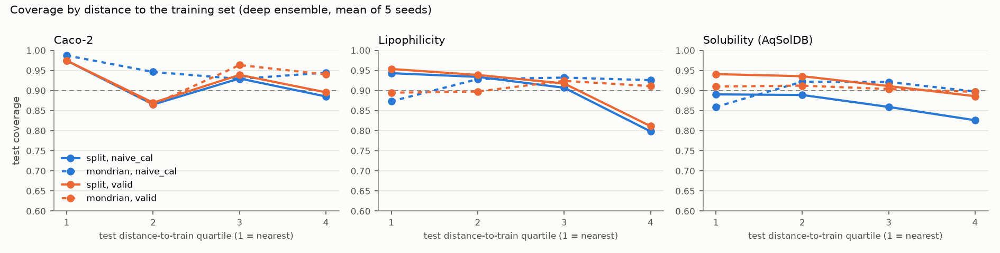
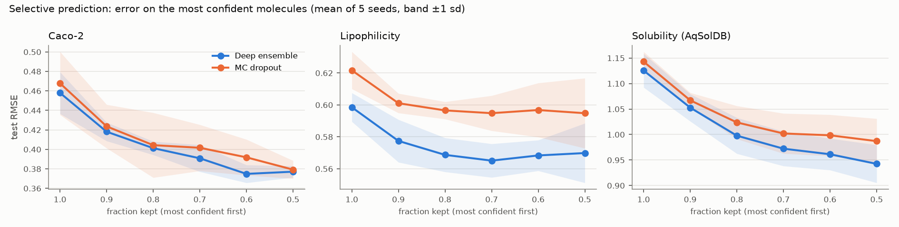

# MolCalib results summary

Generated by `scripts/evaluate.py` from the files in `results/`; no number below is typed by hand.
Code commit of the statistics: `8c3c483e306a3392c14d0d0c597e73e250a0a028`.

Setup: tasks `caco2_wang`, `lipophilicity_astrazeneca`, `solubility_aqsoldb`; split seeds 1, 2, 3, 4, 5;
target coverage 90% (alpha = 0.1); 5-member deep ensemble and
MC dropout with T = 30; 1000 scaffold-group bootstrap resamples.

How to read the intervals:
- "mean ± sd" is over the 5 split seeds on the full test set.
- "[a, b]" after a value is a 95% CI from resampling test scaffold groups only (models and
  calibration fixed).
- A second "[a, b]" (conformal tables) also resamples calibration scaffold groups and refits the
  conformal quantiles (DR-005). Use this one for questions about the calibration source.
- No correction for multiple comparisons is applied.

## 1. Splits

| Task | train_fit | naive_cal | valid | test | Max scaffold overlap (5 seeds) | naive_cal sharing a train scaffold (mean) |
|---|---|---|---|---|---|---|
| Caco-2 | 573 | 64 | 91 | 182 | 0 | 0.60 |
| Lipophilicity | 2646 | 294 | 420 | 840 | 0 | 0.54 |
| Solubility (AqSolDB) | 6287 | 699 | 999 | 1995 | 0 | 0.89 |

Split sizes are for seed 1. 

## 2. Accuracy and model uncertainty (test set)

Miscal. signed < 0 means the model's own Gaussian intervals are too narrow.

| Task | Method | MAE | RMSE | NLL | Miscal. area | Miscal. signed | Spearman σ vs abs. error |
|---|---|---|---|---|---|---|---|
| Caco-2 | Deep ensemble | 0.355 ± 0.010 [0.301, 0.436] | 0.458 ± 0.021 [0.383, 0.551] | 0.625 ± 0.033 [0.423, 0.936] | 0.049 ± 0.013 [0.026, 0.140] | -0.049 ± 0.013 [-0.140, 0.016] | 0.199 ± 0.039 [0.015, 0.397] |
| Caco-2 | MC dropout | 0.365 ± 0.028 [0.311, 0.435] | 0.468 ± 0.032 [0.395, 0.548] | 0.654 ± 0.048 [0.443, 0.948] | 0.069 ± 0.020 [0.037, 0.138] | -0.068 ± 0.020 [-0.137, -0.020] | 0.231 ± 0.116 [0.048, 0.398] |
| Lipophilicity | Deep ensemble | 0.452 ± 0.005 [0.423, 0.484] | 0.599 ± 0.009 [0.554, 0.648] | 1.034 ± 0.026 [0.893, 1.214] | 0.073 ± 0.007 [0.048, 0.102] | -0.073 ± 0.007 [-0.102, -0.047] | 0.090 ± 0.026 [0.010, 0.173] |
| Lipophilicity | MC dropout | 0.470 ± 0.008 [0.440, 0.501] | 0.622 ± 0.012 [0.578, 0.672] | 1.107 ± 0.035 [0.960, 1.283] | 0.081 ± 0.002 [0.056, 0.108] | -0.081 ± 0.002 [-0.108, -0.056] | 0.071 ± 0.021 [0.001, 0.145] |
| Solubility (AqSolDB) | Deep ensemble | 0.809 ± 0.024 [0.744, 0.889] | 1.125 ± 0.033 [1.034, 1.238] | 1.911 ± 0.070 [1.663, 2.240] | 0.094 ± 0.011 [0.062, 0.124] | -0.094 ± 0.011 [-0.124, -0.060] | 0.191 ± 0.021 [0.136, 0.244] |
| Solubility (AqSolDB) | MC dropout | 0.821 ± 0.011 [0.753, 0.904] | 1.143 ± 0.019 [1.049, 1.261] | 1.998 ± 0.119 [1.732, 2.345] | 0.095 ± 0.013 [0.057, 0.127] | -0.095 ± 0.013 [-0.127, -0.056] | 0.170 ± 0.038 [0.110, 0.226] |

## 3. Conformal coverage (target 90%)

Each cell: mean, 95% CI (test), 95% CI (test + calibration).

| Task | Method | Variant | naive_cal | valid |
|---|---|---|---|---|
| Caco-2 | Deep ensemble | split | 0.916 [0.853, 0.957] [0.839, 0.956] | 0.922 [0.857, 0.966] [0.847, 0.966] |
| Caco-2 | Deep ensemble | normalized | 0.938 [0.872, 0.979] [0.861, 0.978] | 0.949 [0.890, 0.986] [0.865, 0.982] |
| Caco-2 | Deep ensemble | mondrian | 0.953 [0.921, 0.973] [0.875, 0.969] | 0.937 [0.879, 0.975] [0.843, 0.967] |
| Caco-2 | Deep ensemble | mondrian_normalized | 0.975 [0.945, 0.994] [0.902, 0.988] | 0.960 [0.908, 0.989] [0.873, 0.984] |
| Caco-2 | MC dropout | split | 0.908 [0.842, 0.953] [0.824, 0.953] | 0.922 [0.861, 0.964] [0.852, 0.964] |
| Caco-2 | MC dropout | normalized | 0.936 [0.864, 0.979] [0.850, 0.977] | 0.938 [0.873, 0.979] [0.872, 0.981] |
| Caco-2 | MC dropout | mondrian | 0.958 [0.922, 0.982] [0.878, 0.973] | 0.937 [0.882, 0.973] [0.856, 0.967] |
| Caco-2 | MC dropout | mondrian_normalized | 0.986 [0.963, 0.998] [0.911, 0.992] | 0.960 [0.912, 0.987] [0.878, 0.982] |
| Lipophilicity | Deep ensemble | split | 0.896 [0.874, 0.915] [0.856, 0.920] | 0.906 [0.887, 0.923] [0.877, 0.928] |
| Lipophilicity | Deep ensemble | normalized | 0.865 [0.836, 0.891] [0.833, 0.901] | 0.887 [0.860, 0.911] [0.845, 0.915] |
| Lipophilicity | Deep ensemble | mondrian | 0.915 [0.894, 0.933] [0.877, 0.934] | 0.907 [0.885, 0.926] [0.866, 0.925] |
| Lipophilicity | Deep ensemble | mondrian_normalized | 0.884 [0.855, 0.909] [0.850, 0.914] | 0.879 [0.849, 0.905] [0.841, 0.907] |
| Lipophilicity | MC dropout | split | 0.891 [0.872, 0.908] [0.862, 0.918] | 0.913 [0.895, 0.929] [0.876, 0.931] |
| Lipophilicity | MC dropout | normalized | 0.886 [0.860, 0.908] [0.848, 0.910] | 0.899 [0.877, 0.919] [0.860, 0.921] |
| Lipophilicity | MC dropout | mondrian | 0.914 [0.895, 0.931] [0.884, 0.935] | 0.913 [0.895, 0.930] [0.871, 0.926] |
| Lipophilicity | MC dropout | mondrian_normalized | 0.894 [0.868, 0.915] [0.861, 0.922] | 0.896 [0.869, 0.918] [0.854, 0.914] |
| Solubility (AqSolDB) | Deep ensemble | split | 0.866 [0.837, 0.888] [0.828, 0.905] | 0.918 [0.896, 0.935] [0.892, 0.938] |
| Solubility (AqSolDB) | Deep ensemble | normalized | 0.861 [0.836, 0.884] [0.830, 0.891] | 0.901 [0.881, 0.920] [0.876, 0.925] |
| Solubility (AqSolDB) | Deep ensemble | mondrian | 0.900 [0.879, 0.918] [0.869, 0.927] | 0.906 [0.883, 0.923] [0.880, 0.925] |
| Solubility (AqSolDB) | Deep ensemble | mondrian_normalized | 0.909 [0.890, 0.925] [0.874, 0.931] | 0.890 [0.867, 0.909] [0.863, 0.914] |
| Solubility (AqSolDB) | MC dropout | split | 0.868 [0.839, 0.891] [0.834, 0.907] | 0.918 [0.895, 0.934] [0.893, 0.938] |
| Solubility (AqSolDB) | MC dropout | normalized | 0.858 [0.830, 0.883] [0.821, 0.890] | 0.905 [0.882, 0.924] [0.877, 0.927] |
| Solubility (AqSolDB) | MC dropout | mondrian | 0.904 [0.884, 0.920] [0.874, 0.930] | 0.907 [0.884, 0.925] [0.879, 0.926] |
| Solubility (AqSolDB) | MC dropout | mondrian_normalized | 0.910 [0.891, 0.925] [0.874, 0.929] | 0.897 [0.875, 0.916] [0.866, 0.918] |

### Mean interval width

| Task | Method | Variant | naive_cal | valid |
|---|---|---|---|---|
| Caco-2 | Deep ensemble | split | 1.667 [1.667, 1.667] [1.453, 1.794] | 1.680 [1.680, 1.680] [1.497, 1.793] |
| Caco-2 | Deep ensemble | normalized | 1.743 [1.576, 1.861] [1.522, 1.963] | 1.805 [1.632, 1.928] [1.544, 2.043] |
| Caco-2 | Deep ensemble | mondrian | 2.350 [2.255, 2.418] [1.761, 2.367] | 1.913 [1.708, 2.102] [1.596, inf] |
| Caco-2 | Deep ensemble | mondrian_normalized | 2.260 [2.043, 2.405] [1.776, 2.326] | 2.071 [1.801, 2.274] [1.629, inf] |
| Caco-2 | MC dropout | split | 1.658 [1.658, 1.658] [1.455, 1.786] | 1.651 [1.651, 1.651] [1.513, 1.771] |
| Caco-2 | MC dropout | normalized | 1.707 [1.550, 1.817] [1.500, 1.908] | 1.779 [1.615, 1.895] [1.569, 2.010] |
| Caco-2 | MC dropout | mondrian | 2.366 [2.246, 2.442] [1.733, 2.386] | 1.883 [1.714, 2.032] [1.597, inf] |
| Caco-2 | MC dropout | mondrian_normalized | 2.200 [1.990, 2.340] [1.739, 2.261] | 2.040 [1.782, 2.226] [1.625, inf] |
| Lipophilicity | Deep ensemble | split | 1.827 [1.827, 1.827] [1.700, 1.991] | 1.928 [1.928, 1.928] [1.799, 2.053] |
| Lipophilicity | Deep ensemble | normalized | 1.752 [1.713, 1.792] [1.646, 1.902] | 1.855 [1.813, 1.897] [1.711, 1.976] |
| Lipophilicity | Deep ensemble | mondrian | 1.999 [1.954, 2.046] [1.871, 2.241] | 1.909 [1.872, 1.947] [1.779, 2.035] |
| Lipophilicity | Deep ensemble | mondrian_normalized | 1.952 [1.881, 2.021] [1.823, 2.139] | 1.836 [1.775, 1.895] [1.721, 1.974] |
| Lipophilicity | MC dropout | split | 1.905 [1.905, 1.905] [1.798, 2.060] | 2.051 [2.051, 2.051] [1.859, 2.240] |
| Lipophilicity | MC dropout | normalized | 1.896 [1.856, 1.936] [1.769, 2.031] | 1.998 [1.956, 2.040] [1.812, 2.135] |
| Lipophilicity | MC dropout | mondrian | 2.067 [2.026, 2.109] [1.954, 2.299] | 2.050 [2.004, 2.097] [1.870, 2.155] |
| Lipophilicity | MC dropout | mondrian_normalized | 2.035 [1.965, 2.101] [1.912, 2.250] | 2.004 [1.939, 2.068] [1.832, 2.100] |
| Solubility (AqSolDB) | Deep ensemble | split | 3.053 [3.053, 3.053] [2.838, 3.529] | 3.911 [3.911, 3.911] [3.751, 4.120] |
| Solubility (AqSolDB) | Deep ensemble | normalized | 3.163 [3.018, 3.332] [2.960, 3.457] | 3.596 [3.433, 3.788] [3.385, 3.863] |
| Solubility (AqSolDB) | Deep ensemble | mondrian | 3.657 [3.580, 3.738] [3.369, 4.219] | 3.625 [3.573, 3.688] [3.466, 3.845] |
| Solubility (AqSolDB) | Deep ensemble | mondrian_normalized | 3.837 [3.659, 4.044] [3.454, 4.353] | 3.502 [3.332, 3.705] [3.298, 3.789] |
| Solubility (AqSolDB) | MC dropout | split | 3.106 [3.106, 3.106] [2.898, 3.557] | 3.974 [3.974, 3.974] [3.822, 4.168] |
| Solubility (AqSolDB) | MC dropout | normalized | 3.234 [3.087, 3.400] [2.991, 3.533] | 3.804 [3.634, 3.999] [3.568, 4.058] |
| Solubility (AqSolDB) | MC dropout | mondrian | 3.772 [3.682, 3.869] [3.466, 4.317] | 3.643 [3.593, 3.703] [3.487, 3.873] |
| Solubility (AqSolDB) | MC dropout | mondrian_normalized | 3.934 [3.750, 4.133] [3.599, 4.487] | 3.651 [3.484, 3.859] [3.430, 3.909] |

### Coverage in the farthest test distance quartile

| Task | Method | Variant | naive_cal | valid |
|---|---|---|---|---|
| Caco-2 | Deep ensemble | split | 0.885 [0.572, 0.951] [0.566, 0.958] | 0.896 [0.571, 0.959] [0.565, 0.965] |
| Caco-2 | Deep ensemble | normalized | 0.944 [0.651, 0.989] [0.656, 0.986] | 0.950 [0.670, 0.990] [0.636, 0.987] |
| Caco-2 | Deep ensemble | mondrian | 0.945 [0.687, 0.980] [0.634, 0.979] | 0.940 [0.656, 0.984] [0.636, 0.982] |
| Caco-2 | Deep ensemble | mondrian_normalized | 0.973 [0.888, 1.000] [0.754, 0.997] | 0.970 [0.917, 0.994] [0.759, 0.997] |
| Caco-2 | MC dropout | split | 0.885 [0.589, 0.945] [0.589, 0.951] | 0.899 [0.589, 0.961] [0.589, 0.961] |
| Caco-2 | MC dropout | normalized | 0.936 [0.676, 0.973] [0.640, 0.979] | 0.946 [0.699, 0.979] [0.658, 0.986] |
| Caco-2 | MC dropout | mondrian | 0.954 [0.719, 1.000] [0.647, 0.980] | 0.940 [0.671, 0.982] [0.635, 0.985] |
| Caco-2 | MC dropout | mondrian_normalized | 0.989 [0.944, 1.000] [0.849, 1.000] | 0.980 [0.944, 0.995] [0.761, 1.000] |
| Lipophilicity | Deep ensemble | split | 0.798 [0.750, 0.844] [0.728, 0.847] | 0.811 [0.765, 0.855] [0.756, 0.858] |
| Lipophilicity | Deep ensemble | normalized | 0.799 [0.748, 0.845] [0.746, 0.858] | 0.826 [0.775, 0.870] [0.760, 0.872] |
| Lipophilicity | Deep ensemble | mondrian | 0.926 [0.891, 0.955] [0.866, 0.959] | 0.911 [0.874, 0.941] [0.838, 0.940] |
| Lipophilicity | Deep ensemble | mondrian_normalized | 0.914 [0.881, 0.943] [0.861, 0.947] | 0.893 [0.856, 0.927] [0.825, 0.927] |
| Lipophilicity | MC dropout | split | 0.797 [0.752, 0.839] [0.747, 0.851] | 0.817 [0.777, 0.857] [0.754, 0.862] |
| Lipophilicity | MC dropout | normalized | 0.817 [0.771, 0.857] [0.766, 0.859] | 0.829 [0.786, 0.868] [0.768, 0.871] |
| Lipophilicity | MC dropout | mondrian | 0.921 [0.889, 0.949] [0.873, 0.956] | 0.922 [0.890, 0.948] [0.848, 0.943] |
| Lipophilicity | MC dropout | mondrian_normalized | 0.913 [0.881, 0.944] [0.861, 0.945] | 0.911 [0.878, 0.941] [0.849, 0.936] |
| Solubility (AqSolDB) | Deep ensemble | split | 0.826 [0.786, 0.863] [0.776, 0.876] | 0.886 [0.856, 0.911] [0.855, 0.915] |
| Solubility (AqSolDB) | Deep ensemble | normalized | 0.825 [0.795, 0.856] [0.788, 0.860] | 0.866 [0.838, 0.895] [0.837, 0.898] |
| Solubility (AqSolDB) | Deep ensemble | mondrian | 0.898 [0.870, 0.921] [0.857, 0.939] | 0.897 [0.870, 0.921] [0.864, 0.925] |
| Solubility (AqSolDB) | Deep ensemble | mondrian_normalized | 0.905 [0.882, 0.928] [0.861, 0.941] | 0.891 [0.866, 0.916] [0.859, 0.918] |
| Solubility (AqSolDB) | MC dropout | split | 0.820 [0.783, 0.854] [0.777, 0.869] | 0.883 [0.855, 0.908] [0.849, 0.910] |
| Solubility (AqSolDB) | MC dropout | normalized | 0.804 [0.771, 0.839] [0.765, 0.843] | 0.852 [0.823, 0.883] [0.819, 0.887] |
| Solubility (AqSolDB) | MC dropout | mondrian | 0.904 [0.876, 0.927] [0.858, 0.939] | 0.895 [0.868, 0.918] [0.859, 0.922] |
| Solubility (AqSolDB) | MC dropout | mondrian_normalized | 0.893 [0.868, 0.919] [0.851, 0.935] | 0.902 [0.878, 0.927] [0.861, 0.926] |

## 4. Paired comparisons

### valid minus naive_cal calibration

| Task | Method | Variant | Metric | Mean diff | 95% CI (test) | 95% CI (test+cal) | Seeds > 0 |
|---|---|---|---|---|---|---|---|
| Caco-2 | Deep ensemble | split | coverage | +0.005 | [-0.007, +0.016] | [-0.024, +0.042] | 4/5 |
| Caco-2 | Deep ensemble | split | mean_width | +0.013 | [+0.013, +0.013] | [-0.186, +0.253] | 4/5 |
| Caco-2 | Deep ensemble | split | coverage_far_bin | +0.010 | [-0.020, +0.023] | [-0.034, +0.037] | 3/5 |
| Caco-2 | Deep ensemble | normalized | coverage | +0.011 | [+0.004, +0.020] | [-0.035, +0.045] | 2/5 |
| Caco-2 | Deep ensemble | normalized | mean_width | +0.062 | [+0.055, +0.068] | [-0.204, +0.311] | 2/5 |
| Caco-2 | Deep ensemble | normalized | coverage_far_bin | +0.006 | [+0.000, +0.033] | [-0.084, +0.079] | 1/5 |
| Caco-2 | Deep ensemble | mondrian | coverage | -0.015 | [-0.048, +0.007] | [-0.069, +0.028] | 1/5 |
| Caco-2 | Deep ensemble | mondrian | mean_width | -0.437 | [-0.627, -0.259] | [-0.623, +inf] | 1/5 |
| Caco-2 | Deep ensemble | mondrian | coverage_far_bin | -0.004 | [-0.066, +0.017] | [-0.088, +0.140] | 3/5 |
| Caco-2 | Deep ensemble | mondrian_normalized | coverage | -0.014 | [-0.039, +0.000] | [-0.059, +0.026] | 1/5 |
| Caco-2 | Deep ensemble | mondrian_normalized | mean_width | -0.189 | [-0.311, -0.081] | [-0.431, +inf] | 2/5 |
| Caco-2 | Deep ensemble | mondrian_normalized | coverage_far_bin | -0.003 | [-0.032, +0.043] | [-0.132, +0.136] | 1/5 |
| Caco-2 | MC dropout | split | coverage | +0.014 | [+0.003, +0.023] | [-0.024, +0.062] | 3/5 |
| Caco-2 | MC dropout | split | mean_width | -0.007 | [-0.007, -0.007] | [-0.195, +0.246] | 3/5 |
| Caco-2 | MC dropout | split | coverage_far_bin | +0.014 | [+0.000, +0.020] | [-0.033, +0.055] | 2/5 |
| Caco-2 | MC dropout | normalized | coverage | +0.002 | [-0.003, +0.009] | [-0.027, +0.054] | 2/5 |
| Caco-2 | MC dropout | normalized | mean_width | +0.073 | [+0.066, +0.077] | [-0.145, +0.311] | 3/5 |
| Caco-2 | MC dropout | normalized | coverage_far_bin | +0.010 | [+0.000, +0.037] | [-0.060, +0.100] | 1/5 |
| Caco-2 | MC dropout | mondrian | coverage | -0.021 | [-0.043, -0.007] | [-0.068, +0.035] | 1/5 |
| Caco-2 | MC dropout | mondrian | mean_width | -0.483 | [-0.601, -0.379] | [-0.604, +inf] | 1/5 |
| Caco-2 | MC dropout | mondrian | coverage_far_bin | -0.014 | [-0.075, +0.011] | [-0.094, +0.055] | 2/5 |
| Caco-2 | MC dropout | mondrian_normalized | coverage | -0.025 | [-0.052, -0.009] | [-0.064, +0.018] | 0/5 |
| Caco-2 | MC dropout | mondrian_normalized | mean_width | -0.160 | [-0.248, -0.084] | [-0.361, +inf] | 1/5 |
| Caco-2 | MC dropout | mondrian_normalized | coverage_far_bin | -0.009 | [-0.021, +0.011] | [-0.168, +0.071] | 1/5 |
| Lipophilicity | Deep ensemble | split | coverage | +0.010 | [+0.005, +0.015] | [-0.018, +0.045] | 4/5 |
| Lipophilicity | Deep ensemble | split | mean_width | +0.101 | [+0.101, +0.101] | [-0.097, +0.288] | 4/5 |
| Lipophilicity | Deep ensemble | split | coverage_far_bin | +0.013 | [+0.003, +0.024] | [-0.032, +0.064] | 4/5 |
| Lipophilicity | Deep ensemble | normalized | coverage | +0.022 | [+0.017, +0.027] | [-0.019, +0.049] | 3/5 |
| Lipophilicity | Deep ensemble | normalized | mean_width | +0.102 | [+0.100, +0.105] | [-0.108, +0.252] | 3/5 |
| Lipophilicity | Deep ensemble | normalized | coverage_far_bin | +0.027 | [+0.018, +0.038] | [-0.028, +0.059] | 3/5 |
| Lipophilicity | Deep ensemble | mondrian | coverage | -0.008 | [-0.014, -0.002] | [-0.043, +0.018] | 1/5 |
| Lipophilicity | Deep ensemble | mondrian | mean_width | -0.091 | [-0.104, -0.077] | [-0.367, +0.073] | 1/5 |
| Lipophilicity | Deep ensemble | mondrian | coverage_far_bin | -0.015 | [-0.026, -0.005] | [-0.080, +0.028] | 2/5 |
| Lipophilicity | Deep ensemble | mondrian_normalized | coverage | -0.005 | [-0.011, +0.001] | [-0.038, +0.018] | 1/5 |
| Lipophilicity | Deep ensemble | mondrian_normalized | mean_width | -0.116 | [-0.131, -0.101] | [-0.317, +0.046] | 0/5 |
| Lipophilicity | Deep ensemble | mondrian_normalized | coverage_far_bin | -0.022 | [-0.035, -0.010] | [-0.080, +0.018] | 1/5 |
| Lipophilicity | MC dropout | split | coverage | +0.021 | [+0.017, +0.027] | [-0.016, +0.043] | 2/5 |
| Lipophilicity | MC dropout | split | mean_width | +0.145 | [+0.145, +0.145] | [-0.103, +0.356] | 3/5 |
| Lipophilicity | MC dropout | split | coverage_far_bin | +0.020 | [+0.010, +0.031] | [-0.039, +0.057] | 2/5 |
| Lipophilicity | MC dropout | normalized | coverage | +0.013 | [+0.009, +0.017] | [-0.019, +0.044] | 3/5 |
| Lipophilicity | MC dropout | normalized | mean_width | +0.102 | [+0.100, +0.104] | [-0.111, +0.281] | 3/5 |
| Lipophilicity | MC dropout | normalized | coverage_far_bin | +0.012 | [+0.003, +0.022] | [-0.031, +0.049] | 3/5 |
| Lipophilicity | MC dropout | mondrian | coverage | -0.001 | [-0.007, +0.005] | [-0.040, +0.020] | 2/5 |
| Lipophilicity | MC dropout | mondrian | mean_width | -0.017 | [-0.030, -0.003] | [-0.315, +0.108] | 2/5 |
| Lipophilicity | MC dropout | mondrian | coverage_far_bin | +0.001 | [-0.013, +0.013] | [-0.071, +0.034] | 2/5 |
| Lipophilicity | MC dropout | mondrian_normalized | coverage | +0.002 | [-0.003, +0.008] | [-0.036, +0.022] | 2/5 |
| Lipophilicity | MC dropout | mondrian_normalized | mean_width | -0.031 | [-0.043, -0.018] | [-0.301, +0.092] | 2/5 |
| Lipophilicity | MC dropout | mondrian_normalized | coverage_far_bin | -0.002 | [-0.011, +0.007] | [-0.055, +0.032] | 2/5 |
| Solubility (AqSolDB) | Deep ensemble | split | coverage | +0.052 | [+0.044, +0.061] | [+0.016, +0.082] | 5/5 |
| Solubility (AqSolDB) | Deep ensemble | split | mean_width | +0.858 | [+0.858, +0.858] | [+0.369, +1.149] | 5/5 |
| Solubility (AqSolDB) | Deep ensemble | split | coverage_far_bin | +0.060 | [+0.044, +0.078] | [+0.023, +0.098] | 5/5 |
| Solubility (AqSolDB) | Deep ensemble | normalized | coverage | +0.040 | [+0.034, +0.047] | [+0.015, +0.064] | 4/5 |
| Solubility (AqSolDB) | Deep ensemble | normalized | mean_width | +0.434 | [+0.414, +0.456] | [+0.165, +0.662] | 4/5 |
| Solubility (AqSolDB) | Deep ensemble | normalized | coverage_far_bin | +0.041 | [+0.032, +0.049] | [+0.016, +0.068] | 4/5 |
| Solubility (AqSolDB) | Deep ensemble | mondrian | coverage | +0.006 | [-0.001, +0.011] | [-0.019, +0.031] | 3/5 |
| Solubility (AqSolDB) | Deep ensemble | mondrian | mean_width | -0.031 | [-0.078, +0.020] | [-0.613, +0.297] | 2/5 |
| Solubility (AqSolDB) | Deep ensemble | mondrian | coverage_far_bin | -0.001 | [-0.005, +0.004] | [-0.039, +0.035] | 3/5 |
| Solubility (AqSolDB) | Deep ensemble | mondrian_normalized | coverage | -0.019 | [-0.024, -0.013] | [-0.039, +0.013] | 1/5 |
| Solubility (AqSolDB) | Deep ensemble | mondrian_normalized | mean_width | -0.336 | [-0.373, -0.304] | [-0.772, +0.032] | 1/5 |
| Solubility (AqSolDB) | Deep ensemble | mondrian_normalized | coverage_far_bin | -0.014 | [-0.022, -0.007] | [-0.054, +0.029] | 2/5 |
| Solubility (AqSolDB) | MC dropout | split | coverage | +0.050 | [+0.042, +0.059] | [+0.017, +0.077] | 5/5 |
| Solubility (AqSolDB) | MC dropout | split | mean_width | +0.868 | [+0.868, +0.868] | [+0.387, +1.146] | 5/5 |
| Solubility (AqSolDB) | MC dropout | split | coverage_far_bin | +0.063 | [+0.050, +0.080] | [+0.020, +0.091] | 5/5 |
| Solubility (AqSolDB) | MC dropout | normalized | coverage | +0.047 | [+0.040, +0.054] | [+0.021, +0.072] | 5/5 |
| Solubility (AqSolDB) | MC dropout | normalized | mean_width | +0.571 | [+0.547, +0.600] | [+0.280, +0.825] | 5/5 |
| Solubility (AqSolDB) | MC dropout | normalized | coverage_far_bin | +0.047 | [+0.038, +0.057] | [+0.020, +0.076] | 5/5 |
| Solubility (AqSolDB) | MC dropout | mondrian | coverage | +0.003 | [-0.005, +0.011] | [-0.024, +0.027] | 1/5 |
| Solubility (AqSolDB) | MC dropout | mondrian | mean_width | -0.129 | [-0.186, -0.064] | [-0.705, +0.241] | 1/5 |
| Solubility (AqSolDB) | MC dropout | mondrian | coverage_far_bin | -0.009 | [-0.016, -0.003] | [-0.046, +0.032] | 2/5 |
| Solubility (AqSolDB) | MC dropout | mondrian_normalized | coverage | -0.013 | [-0.019, -0.007] | [-0.035, +0.014] | 2/5 |
| Solubility (AqSolDB) | MC dropout | mondrian_normalized | mean_width | -0.283 | [-0.336, -0.243] | [-0.769, +0.061] | 2/5 |
| Solubility (AqSolDB) | MC dropout | mondrian_normalized | coverage_far_bin | +0.009 | [+0.003, +0.016] | [-0.042, +0.045] | 2/5 |

### Deep ensemble minus MC dropout

Point metrics, and split-conformal coverage and width. "—": not applicable (point metrics have
no calibration step to resample).

| Task | Variant | Source | Metric | Mean diff | 95% CI (test) | 95% CI (test+cal) | Seeds > 0 |
|---|---|---|---|---|---|---|---|
| Caco-2 |  |  | mae | -0.010 | [-0.030, +0.013] | — | 3/5 |
| Caco-2 |  |  | rmse | -0.010 | [-0.029, +0.015] | — | 3/5 |
| Caco-2 |  |  | nll | -0.029 | [-0.069, +0.030] | — | 2/5 |
| Caco-2 |  |  | miscal_area | -0.020 | [-0.033, +0.012] | — | 1/5 |
| Caco-2 |  |  | spearman_sigma_abserr | -0.033 | [-0.086, +0.047] | — | 2/5 |
| Caco-2 | split | naive_cal | coverage | +0.009 | [-0.013, +0.024] | [-0.024, +0.040] | 3/5 |
| Caco-2 | split | naive_cal | mean_width | +0.010 | [+0.010, +0.010] | [-0.112, +0.110] | 2/5 |
| Caco-2 | split | valid | coverage | +0.000 | [-0.016, +0.011] | [-0.023, +0.025] | 2/5 |
| Caco-2 | split | valid | mean_width | +0.029 | [+0.029, +0.029] | [-0.102, +0.119] | 3/5 |
| Lipophilicity |  |  | mae | -0.018 | [-0.024, -0.013] | — | 0/5 |
| Lipophilicity |  |  | rmse | -0.023 | [-0.031, -0.016] | — | 0/5 |
| Lipophilicity |  |  | nll | -0.072 | [-0.099, -0.049] | — | 0/5 |
| Lipophilicity |  |  | miscal_area | -0.008 | [-0.014, -0.002] | — | 1/5 |
| Lipophilicity |  |  | spearman_sigma_abserr | +0.019 | [-0.006, +0.044] | — | 5/5 |
| Lipophilicity | split | naive_cal | coverage | +0.005 | [-0.002, +0.012] | [-0.018, +0.014] | 3/5 |
| Lipophilicity | split | naive_cal | mean_width | -0.079 | [-0.079, -0.079] | [-0.175, -0.015] | 2/5 |
| Lipophilicity | split | valid | coverage | -0.007 | [-0.013, -0.001] | [-0.016, +0.012] | 1/5 |
| Lipophilicity | split | valid | mean_width | -0.123 | [-0.123, -0.123] | [-0.226, -0.005] | 1/5 |
| Solubility (AqSolDB) |  |  | mae | -0.012 | [-0.021, -0.004] | — | 1/5 |
| Solubility (AqSolDB) |  |  | rmse | -0.017 | [-0.035, -0.005] | — | 1/5 |
| Solubility (AqSolDB) |  |  | nll | -0.087 | [-0.156, -0.033] | — | 1/5 |
| Solubility (AqSolDB) |  |  | miscal_area | -0.001 | [-0.008, +0.006] | — | 3/5 |
| Solubility (AqSolDB) |  |  | spearman_sigma_abserr | +0.021 | [+0.004, +0.039] | — | 4/5 |
| Solubility (AqSolDB) | split | naive_cal | coverage | -0.002 | [-0.006, +0.003] | [-0.014, +0.009] | 3/5 |
| Solubility (AqSolDB) | split | naive_cal | mean_width | -0.053 | [-0.053, -0.053] | [-0.176, +0.071] | 2/5 |
| Solubility (AqSolDB) | split | valid | coverage | +0.001 | [-0.003, +0.004] | [-0.006, +0.006] | 1/5 |
| Solubility (AqSolDB) | split | valid | mean_width | -0.063 | [-0.063, -0.063] | [-0.129, +0.020] | 2/5 |

## 5. Selective prediction (test RMSE, mean of seeds)

| Task | Method | keep 100% | keep 90% | keep 80% | keep 70% | keep 60% | keep 50% |
|---|---|---|---|---|---|---|---|
| Caco-2 | Deep ensemble | 0.458 | 0.418 | 0.401 | 0.391 | 0.375 | 0.377 |
| Caco-2 | MC dropout | 0.468 | 0.424 | 0.404 | 0.402 | 0.392 | 0.379 |
| Lipophilicity | Deep ensemble | 0.599 | 0.577 | 0.569 | 0.565 | 0.568 | 0.570 |
| Lipophilicity | MC dropout | 0.622 | 0.601 | 0.597 | 0.595 | 0.597 | 0.595 |
| Solubility (AqSolDB) | Deep ensemble | 1.125 | 1.053 | 0.998 | 0.972 | 0.961 | 0.943 |
| Solubility (AqSolDB) | MC dropout | 1.143 | 1.067 | 1.024 | 1.002 | 0.999 | 0.987 |

## 6. Compute cost (Kaggle, 2 × T4)

| Task | Method | Models per seed | GPU-min, 5 seeds | GPU-min per model | NLL | Split coverage (valid cal) |
|---|---|---|---|---|---|---|
| Caco-2 | Deep ensemble | 5 | 2.7 | 0.11 | 0.625 | 0.922 |
| Caco-2 | MC dropout | 1 | 0.6 | 0.12 | 0.654 | 0.922 |
| Lipophilicity | Deep ensemble | 5 | 12.0 | 0.48 | 1.034 | 0.906 |
| Lipophilicity | MC dropout | 1 | 2.4 | 0.47 | 1.107 | 0.913 |
| Solubility (AqSolDB) | Deep ensemble | 5 | 22.3 | 0.89 | 1.911 | 0.918 |
| Solubility (AqSolDB) | MC dropout | 1 | 4.7 | 0.93 | 1.998 | 0.918 |

## 7. Post-hoc robustness checks (DR-006)

**These checks were chosen after seeing the results above.** They are not part of the planned
analysis and are reported as exploratory. No correction for multiple comparisons is applied.

### 7.1 Size-matched control: `valid` subsampled to the `naive_cal` size

For each task, seed and base method, split and normalized conformal are refit on 200 random
subsamples of `valid` (without replacement) with as many molecules as that seed's `naive_cal`;
the table shows the test metric averaged over subsamples. Each cell: mean ± sd over seeds,
[95% CI, test scaffold groups only]. The CI holds models and calibration sets fixed.

Coverage (target 90%):

| Task | Method | Variant | naive_cal | valid | valid_sizematched |
|---|---|---|---|---|---|
| Caco-2 | Deep ensemble | split | 0.916 ± 0.026 [0.853, 0.957] | 0.922 ± 0.029 [0.857, 0.966] | 0.924 ± 0.028 [0.860, 0.966] |
| Caco-2 | Deep ensemble | normalized | 0.938 ± 0.023 [0.872, 0.979] | 0.949 ± 0.011 [0.890, 0.986] | 0.948 ± 0.015 [0.892, 0.984] |
| Caco-2 | MC dropout | split | 0.908 ± 0.034 [0.842, 0.953] | 0.922 ± 0.015 [0.861, 0.964] | 0.924 ± 0.014 [0.863, 0.965] |
| Caco-2 | MC dropout | normalized | 0.936 ± 0.018 [0.864, 0.979] | 0.938 ± 0.020 [0.873, 0.979] | 0.942 ± 0.020 [0.877, 0.981] |
| Lipophilicity | Deep ensemble | split | 0.896 ± 0.013 [0.874, 0.915] | 0.906 ± 0.031 [0.887, 0.923] | 0.907 ± 0.030 [0.888, 0.924] |
| Lipophilicity | Deep ensemble | normalized | 0.865 ± 0.019 [0.836, 0.891] | 0.887 ± 0.019 [0.860, 0.911] | 0.888 ± 0.019 [0.862, 0.912] |
| Lipophilicity | MC dropout | split | 0.891 ± 0.024 [0.872, 0.908] | 0.913 ± 0.028 [0.895, 0.929] | 0.911 ± 0.028 [0.894, 0.927] |
| Lipophilicity | MC dropout | normalized | 0.886 ± 0.021 [0.860, 0.908] | 0.899 ± 0.027 [0.877, 0.919] | 0.899 ± 0.028 [0.877, 0.919] |
| Solubility (AqSolDB) | Deep ensemble | split | 0.866 ± 0.007 [0.837, 0.888] | 0.918 ± 0.029 [0.896, 0.935] | 0.918 ± 0.029 [0.895, 0.935] |
| Solubility (AqSolDB) | Deep ensemble | normalized | 0.861 ± 0.020 [0.836, 0.884] | 0.901 ± 0.019 [0.881, 0.920] | 0.901 ± 0.018 [0.882, 0.920] |
| Solubility (AqSolDB) | MC dropout | split | 0.868 ± 0.010 [0.839, 0.891] | 0.918 ± 0.030 [0.895, 0.934] | 0.918 ± 0.030 [0.895, 0.934] |
| Solubility (AqSolDB) | MC dropout | normalized | 0.858 ± 0.017 [0.830, 0.883] | 0.905 ± 0.021 [0.882, 0.924] | 0.905 ± 0.022 [0.883, 0.924] |

Mean interval width:

| Task | Method | Variant | naive_cal | valid | valid_sizematched |
|---|---|---|---|---|---|
| Caco-2 | Deep ensemble | split | 1.667 ± 0.277 [1.667, 1.667] | 1.680 ± 0.161 [1.680, 1.680] | 1.688 ± 0.147 [1.688, 1.688] |
| Caco-2 | Deep ensemble | normalized | 1.743 ± 0.194 [1.576, 1.861] | 1.805 ± 0.088 [1.632, 1.928] | 1.849 ± 0.118 [1.672, 1.974] |
| Caco-2 | MC dropout | split | 1.658 ± 0.276 [1.658, 1.658] | 1.651 ± 0.129 [1.651, 1.651] | 1.672 ± 0.118 [1.672, 1.672] |
| Caco-2 | MC dropout | normalized | 1.707 ± 0.124 [1.550, 1.817] | 1.779 ± 0.136 [1.615, 1.895] | 1.797 ± 0.142 [1.631, 1.913] |
| Lipophilicity | Deep ensemble | split | 1.827 ± 0.098 [1.827, 1.827] | 1.928 ± 0.254 [1.928, 1.928] | 1.940 ± 0.259 [1.940, 1.940] |
| Lipophilicity | Deep ensemble | normalized | 1.752 ± 0.092 [1.713, 1.792] | 1.855 ± 0.133 [1.813, 1.897] | 1.867 ± 0.137 [1.824, 1.909] |
| Lipophilicity | MC dropout | split | 1.905 ± 0.139 [1.905, 1.905] | 2.051 ± 0.298 [2.051, 2.051] | 2.055 ± 0.308 [2.055, 2.055] |
| Lipophilicity | MC dropout | normalized | 1.896 ± 0.136 [1.856, 1.936] | 1.998 ± 0.233 [1.956, 2.040] | 2.003 ± 0.239 [1.962, 2.046] |
| Solubility (AqSolDB) | Deep ensemble | split | 3.053 ± 0.090 [3.053, 3.053] | 3.911 ± 0.773 [3.911, 3.911] | 3.923 ± 0.792 [3.923, 3.923] |
| Solubility (AqSolDB) | Deep ensemble | normalized | 3.163 ± 0.175 [3.018, 3.332] | 3.596 ± 0.190 [3.433, 3.788] | 3.621 ± 0.202 [3.456, 3.814] |
| Solubility (AqSolDB) | MC dropout | split | 3.106 ± 0.140 [3.106, 3.106] | 3.974 ± 0.844 [3.974, 3.974] | 3.987 ± 0.872 [3.987, 3.987] |
| Solubility (AqSolDB) | MC dropout | normalized | 3.234 ± 0.135 [3.087, 3.400] | 3.804 ± 0.259 [3.634, 3.999] | 3.811 ± 0.282 [3.640, 4.006] |

### 7.2 Winkler (interval) score, alpha = 0.1

Mean over test molecules of (hi − lo) + (2/alpha)(lo − y)[y < lo] + (2/alpha)(y − hi)[y > hi];
lower is better. It rewards narrow intervals and penalises misses by their distance. Each cell:
mean, 95% CI (test), 95% CI (test + calibration).

| Task | Method | Variant | naive_cal | valid |
|---|---|---|---|---|
| Caco-2 | Deep ensemble | split | 2.048 [1.804, 2.455] [1.770, 2.501] | 2.064 [1.814, 2.488] [1.796, 2.510] |
| Caco-2 | Deep ensemble | normalized | 1.967 [1.758, 2.191] [1.735, 2.214] | 1.989 [1.789, 2.169] [1.788, 2.247] |
| Caco-2 | Deep ensemble | mondrian | 2.549 [2.384, 2.787] [1.992, 2.752] | 2.198 [1.926, 2.412] [1.933, inf] |
| Caco-2 | Deep ensemble | mondrian_normalized | 2.319 [2.113, 2.473] [1.938, 2.417] | 2.192 [1.916, 2.380] [1.866, inf] |
| Caco-2 | MC dropout | split | 2.051 [1.821, 2.413] [1.783, 2.496] | 2.035 [1.801, 2.418] [1.798, 2.433] |
| Caco-2 | MC dropout | normalized | 1.925 [1.699, 2.159] [1.697, 2.208] | 1.961 [1.747, 2.158] [1.748, 2.213] |
| Caco-2 | MC dropout | mondrian | 2.516 [2.356, 2.698] [1.971, 2.669] | 2.147 [1.899, 2.361] [1.896, inf] |
| Caco-2 | MC dropout | mondrian_normalized | 2.240 [2.036, 2.384] [1.894, 2.331] | 2.157 [1.867, 2.348] [1.826, inf] |
| Lipophilicity | Deep ensemble | split | 2.581 [2.360, 2.862] [2.379, 2.883] | 2.612 [2.402, 2.879] [2.407, 2.894] |
| Lipophilicity | Deep ensemble | normalized | 2.608 [2.371, 2.881] [2.387, 2.894] | 2.595 [2.377, 2.853] [2.400, 2.875] |
| Lipophilicity | Deep ensemble | mondrian | 2.558 [2.365, 2.797] [2.414, 2.886] | 2.519 [2.317, 2.775] [2.352, 2.823] |
| Lipophilicity | Deep ensemble | mondrian_normalized | 2.605 [2.410, 2.847] [2.432, 2.897] | 2.567 [2.359, 2.834] [2.384, 2.869] |
| Lipophilicity | MC dropout | split | 2.683 [2.456, 2.966] [2.474, 2.999] | 2.717 [2.506, 2.984] [2.508, 3.012] |
| Lipophilicity | MC dropout | normalized | 2.698 [2.475, 2.970] [2.485, 2.988] | 2.709 [2.501, 2.967] [2.507, 2.996] |
| Lipophilicity | MC dropout | mondrian | 2.652 [2.453, 2.904] [2.501, 2.982] | 2.645 [2.450, 2.895] [2.467, 2.936] |
| Lipophilicity | MC dropout | mondrian_normalized | 2.702 [2.499, 2.948] [2.525, 2.996] | 2.682 [2.476, 2.930] [2.481, 2.968] |
| Solubility (AqSolDB) | Deep ensemble | split | 5.199 [4.689, 5.901] [4.739, 5.914] | 5.286 [4.913, 5.798] [4.916, 5.811] |
| Solubility (AqSolDB) | Deep ensemble | normalized | 4.959 [4.525, 5.525] [4.536, 5.544] | 4.947 [4.560, 5.451] [4.570, 5.458] |
| Solubility (AqSolDB) | Deep ensemble | mondrian | 5.161 [4.772, 5.691] [4.853, 5.859] | 5.131 [4.718, 5.717] [4.738, 5.736] |
| Solubility (AqSolDB) | Deep ensemble | mondrian_normalized | 5.025 [4.663, 5.510] [4.688, 5.666] | 4.899 [4.491, 5.420] [4.540, 5.441] |
| Solubility (AqSolDB) | MC dropout | split | 5.267 [4.752, 5.960] [4.784, 5.986] | 5.375 [4.980, 5.902] [4.987, 5.927] |
| Solubility (AqSolDB) | MC dropout | normalized | 5.136 [4.668, 5.764] [4.694, 5.776] | 5.173 [4.776, 5.725] [4.784, 5.742] |
| Solubility (AqSolDB) | MC dropout | mondrian | 5.253 [4.866, 5.781] [4.925, 5.937] | 5.191 [4.765, 5.769] [4.782, 5.805] |
| Solubility (AqSolDB) | MC dropout | mondrian_normalized | 5.176 [4.801, 5.721] [4.849, 5.882] | 5.039 [4.644, 5.612] [4.668, 5.635] |

`valid` minus `naive_cal` (negative = `valid` calibration scores better):

| Task | Method | Variant | Metric | Mean diff | 95% CI (test) | 95% CI (test+cal) | Seeds > 0 |
|---|---|---|---|---|---|---|---|
| Caco-2 | Deep ensemble | split | winkler | +0.016 | [-0.013, +0.066] | [-0.122, +0.107] | 3/5 |
| Caco-2 | Deep ensemble | normalized | winkler | +0.022 | [-0.027, +0.053] | [-0.106, +0.194] | 2/5 |
| Caco-2 | Deep ensemble | mondrian | winkler | -0.351 | [-0.561, -0.209] | [-0.450, +inf] | 1/5 |
| Caco-2 | Deep ensemble | mondrian_normalized | winkler | -0.127 | [-0.267, -0.019] | [-0.270, +inf] | 2/5 |
| Caco-2 | MC dropout | split | winkler | -0.015 | [-0.065, +0.058] | [-0.164, +0.095] | 2/5 |
| Caco-2 | MC dropout | normalized | winkler | +0.037 | [-0.015, +0.066] | [-0.089, +0.179] | 3/5 |
| Caco-2 | MC dropout | mondrian | winkler | -0.369 | [-0.508, -0.271] | [-0.452, +inf] | 1/5 |
| Caco-2 | MC dropout | mondrian_normalized | winkler | -0.082 | [-0.206, +0.029] | [-0.211, +inf] | 2/5 |
| Lipophilicity | Deep ensemble | split | winkler | +0.031 | [+0.009, +0.053] | [-0.044, +0.082] | 3/5 |
| Lipophilicity | Deep ensemble | normalized | winkler | -0.013 | [-0.039, +0.013] | [-0.066, +0.043] | 3/5 |
| Lipophilicity | Deep ensemble | mondrian | winkler | -0.038 | [-0.071, -0.003] | [-0.194, +0.045] | 1/5 |
| Lipophilicity | Deep ensemble | mondrian_normalized | winkler | -0.038 | [-0.075, +0.004] | [-0.138, +0.048] | 0/5 |
| Lipophilicity | MC dropout | split | winkler | +0.034 | [+0.007, +0.058] | [-0.048, +0.152] | 2/5 |
| Lipophilicity | MC dropout | normalized | winkler | +0.011 | [-0.011, +0.034] | [-0.054, +0.082] | 2/5 |
| Lipophilicity | MC dropout | mondrian | winkler | -0.008 | [-0.036, +0.022] | [-0.169, +0.067] | 2/5 |
| Lipophilicity | MC dropout | mondrian_normalized | winkler | -0.020 | [-0.051, +0.012] | [-0.144, +0.050] | 2/5 |
| Solubility (AqSolDB) | Deep ensemble | split | winkler | +0.087 | [-0.112, +0.240] | [-0.188, +0.222] | 1/5 |
| Solubility (AqSolDB) | Deep ensemble | normalized | winkler | -0.012 | [-0.100, +0.064] | [-0.125, +0.089] | 2/5 |
| Solubility (AqSolDB) | Deep ensemble | mondrian | winkler | -0.031 | [-0.089, +0.041] | [-0.407, +0.035] | 1/5 |
| Solubility (AqSolDB) | Deep ensemble | mondrian_normalized | winkler | -0.126 | [-0.195, -0.051] | [-0.428, -0.009] | 1/5 |
| Solubility (AqSolDB) | MC dropout | split | winkler | +0.109 | [-0.088, +0.256] | [-0.143, +0.243] | 1/5 |
| Solubility (AqSolDB) | MC dropout | normalized | winkler | +0.037 | [-0.075, +0.135] | [-0.127, +0.141] | 4/5 |
| Solubility (AqSolDB) | MC dropout | mondrian | winkler | -0.062 | [-0.136, +0.027] | [-0.365, +0.027] | 1/5 |
| Solubility (AqSolDB) | MC dropout | mondrian_normalized | winkler | -0.137 | [-0.212, -0.053] | [-0.484, -0.026] | 0/5 |

### 7.3 Median absolute error per split (descriptive)

Median |y − μ| on each split, mean ± sd over seeds. No test is applied.

| Task | Method | naive_cal | valid | test |
|---|---|---|---|---|
| Caco-2 | Deep ensemble | 0.29 ± 0.04 | 0.34 ± 0.03 | 0.28 ± 0.02 |
| Caco-2 | MC dropout | 0.30 ± 0.02 | 0.35 ± 0.02 | 0.29 ± 0.04 |
| Lipophilicity | Deep ensemble | 0.33 ± 0.01 | 0.36 ± 0.04 | 0.36 ± 0.01 |
| Lipophilicity | MC dropout | 0.35 ± 0.02 | 0.37 ± 0.04 | 0.38 ± 0.01 |
| Solubility (AqSolDB) | Deep ensemble | 0.41 ± 0.02 | 0.63 ± 0.06 | 0.61 ± 0.02 |
| Solubility (AqSolDB) | MC dropout | 0.43 ± 0.03 | 0.65 ± 0.09 | 0.62 ± 0.02 |

### 7.4 Number of valid − naive_cal comparisons

`stats_paired.csv` holds 186 paired comparisons
(90 deep ensemble − MC dropout,
96 `valid` − `naive_cal`). Of the `valid` − `naive_cal` comparisons,
14 have a 95% test+cal CI that excludes zero, with no
multiple-comparison correction:

| Metric | Comparisons | test+cal CI excludes 0 |
|---|---|---|
| coverage | 24 | 4 |
| mean_width | 24 | 4 |
| coverage_far_bin | 24 | 4 |
| winkler | 24 | 2 |
| all | 96 | 14 |

The comparisons whose test+cal CI excludes zero:

| Task | Method | Variant | Metric | Mean diff | 95% CI (test) | 95% CI (test+cal) | Seeds > 0 |
|---|---|---|---|---|---|---|---|
| Solubility (AqSolDB) | Deep ensemble | split | coverage | +0.052 | [+0.044, +0.061] | [+0.016, +0.082] | 5/5 |
| Solubility (AqSolDB) | Deep ensemble | split | mean_width | +0.858 | [+0.858, +0.858] | [+0.369, +1.149] | 5/5 |
| Solubility (AqSolDB) | Deep ensemble | split | coverage_far_bin | +0.060 | [+0.044, +0.078] | [+0.023, +0.098] | 5/5 |
| Solubility (AqSolDB) | Deep ensemble | normalized | coverage | +0.040 | [+0.034, +0.047] | [+0.015, +0.064] | 4/5 |
| Solubility (AqSolDB) | Deep ensemble | normalized | mean_width | +0.434 | [+0.414, +0.456] | [+0.165, +0.662] | 4/5 |
| Solubility (AqSolDB) | Deep ensemble | normalized | coverage_far_bin | +0.041 | [+0.032, +0.049] | [+0.016, +0.068] | 4/5 |
| Solubility (AqSolDB) | Deep ensemble | mondrian_normalized | winkler | -0.126 | [-0.195, -0.051] | [-0.428, -0.009] | 1/5 |
| Solubility (AqSolDB) | MC dropout | split | coverage | +0.050 | [+0.042, +0.059] | [+0.017, +0.077] | 5/5 |
| Solubility (AqSolDB) | MC dropout | split | mean_width | +0.868 | [+0.868, +0.868] | [+0.387, +1.146] | 5/5 |
| Solubility (AqSolDB) | MC dropout | split | coverage_far_bin | +0.063 | [+0.050, +0.080] | [+0.020, +0.091] | 5/5 |
| Solubility (AqSolDB) | MC dropout | normalized | coverage | +0.047 | [+0.040, +0.054] | [+0.021, +0.072] | 5/5 |
| Solubility (AqSolDB) | MC dropout | normalized | mean_width | +0.571 | [+0.547, +0.600] | [+0.280, +0.825] | 5/5 |
| Solubility (AqSolDB) | MC dropout | normalized | coverage_far_bin | +0.047 | [+0.038, +0.057] | [+0.020, +0.076] | 5/5 |
| Solubility (AqSolDB) | MC dropout | mondrian_normalized | winkler | -0.137 | [-0.212, -0.053] | [-0.484, -0.026] | 0/5 |
